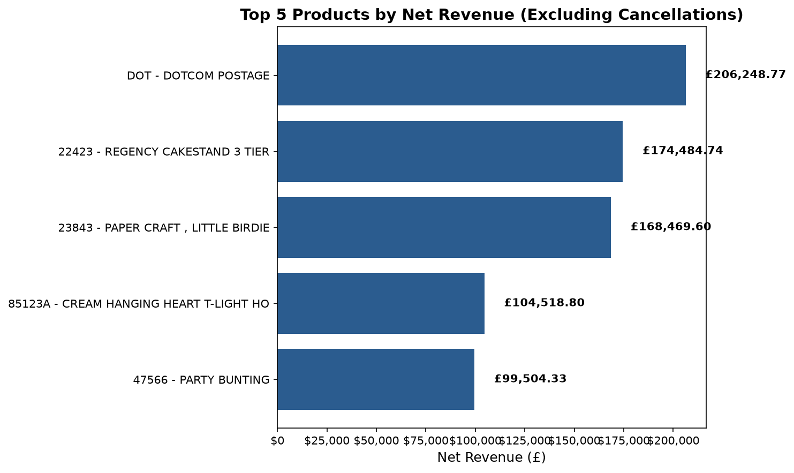

# Self-Correcting SQL & Python Data Analyst Agent

A 100% local, zero-API-key data analysis agent powered by **Pydantic AI**, **Ollama**, **DuckDB**, and **Matplotlib**. Point it at a messy `.csv`, `.xlsx`, or `.parquet` dataset via the CLI or Streamlit Web UI, ask a question in plain English, and get verified SQL metrics, data-quality caveats, and a publication-ready chart.



---

## Architecture & Self-Correction Loop

1. **Isolated Workspace Staging:** Copies or converts input files (`.csv`, `.xlsx`, `.parquet`) into a temporary `tempfile` directory (`data.csv`) so original files remain untouched.
2. **Schema Probing (`inspect_dataset`):** Queries DuckDB (`DESCRIBE`, `COUNT(*)`, `LIMIT 5`) before writing analytical SQL to inspect column names, inferred types, and dirty formatting.
3. **Sandboxed Execution & Retry (`execute_analysis_code`):** Writes pure SQL to `_query.sql`, loads results into a `pandas.DataFrame`, and runs headless Matplotlib (`MPLBACKEND=Agg`) in a subprocess. If DuckDB or Python raises an exception, `stderr` is fed back via `ModelRetry` so the local LLM fixes its own code automatically.
4. **Structured Output (`AnalysisReport`):** Returns a validated Pydantic report containing the plain-English answer, data-quality caveats, chart status, and verified code.

---

## Prerequisites & Local Setup

### 1. Install Ollama & Pull a Local Tool-Calling Model
```bash
brew install ollama
ollama serve &
ollama pull qwen3:8b